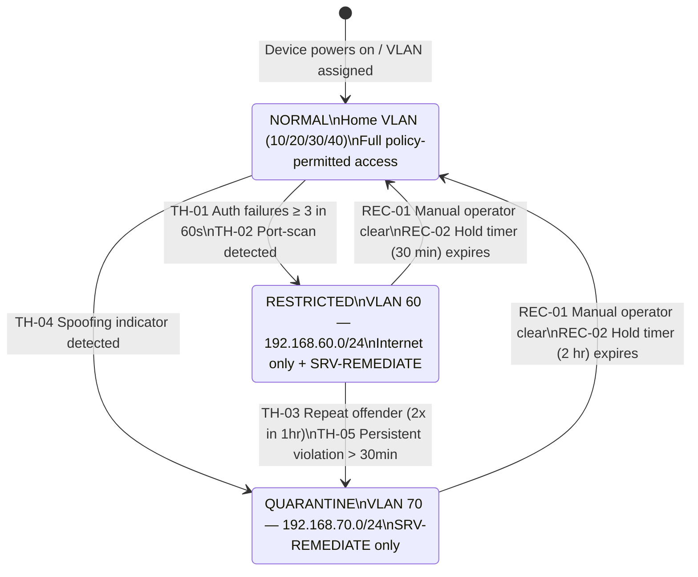

# BACSE203 – Computer Networks Lab Project
# Member 3 Technical Report: Adaptive Policy Engine

---

| Field | Detail |
|-------|--------|
| **Role** | Member 3 – Adaptive Policy Engine |
| **Module** | BACSE203 – Computer Networks Lab |
| **Policy Host** | POLICY-HOST (192.168.40.50, VLAN 40) |
| **Scope** | Dynamic VLAN-based device state management via SSH |

---

## Table of Contents

1. [Introduction & Role Overview](#1-introduction--role-overview)
2. [Adaptive Policy Engine Design](#2-adaptive-policy-engine-design)
3. [State-Transition Diagram](#3-state-transition-diagram)
4. [Implementation Approach](#4-implementation-approach)
5. [POLICY-HOST Configuration](#5-policy-host-configuration)
6. [Containment Command Reference](#6-containment-command-reference)
7. [Verification & Test Plan](#7-verification--test-plan)
8. [References to Member 1 Infrastructure](#8-references-to-member-1-infrastructure)

---

## 1. Introduction & Role Overview

### 1.1 Project Background

This lab project simulates a university research network comprising multiple VLANs for different user categories (Students, Faculty, Research, Admin, Servers). The network is built around a Cisco Catalyst 3560-24PS Layer-3 core switch (CORE-SW), two Cisco Catalyst 2960-24TT access switches (ACCESS-SW-A and ACCESS-SW-B), and a Cisco 2911 edge router (EDGE-R) providing NAT-based internet access.

### 1.2 Member 3 Role

Member 3 is responsible for the **Adaptive Policy Engine** — the component that enforces dynamic security policy by detecting violations or anomalous behaviour and moving offending devices between VLANs without modifying ACL rules or ARP tables. This approach is operationally clean, easily auditable, and reversible.

**Key Responsibilities:**
- Define device states (NORMAL, RESTRICTED, QUARANTINE) and the thresholds that trigger each transition
- Design and document the switchport VLAN reassignment mechanism executed via SSH from POLICY-HOST
- Produce all containment command sets (restrict, quarantine, restore) for every client device in the network
- Establish a recovery / hold-timer mechanism to return devices to their home VLAN
- Verify correct behaviour via a structured test plan

### 1.3 Design Constraints

| Constraint | Detail |
|------------|--------|
| Enforcement method | **Switchport VLAN reassignment only** (no ACL edits, no ARP manipulation) |
| Control plane | POLICY-HOST SSHes into target switch, pushes `switchport access vlan <X>` |
| SSH restriction | VTY lines on all switches accept SSH **only from 192.168.40.50** (enforced by Member 1's baseline `access-class`) |
| Lab password | `Admin@123` (used on all VTY lines and enable secret) |
| Core uplink | CORE-SW ↔ EDGE-R uses **Fa0/24** (Cisco 3560-24PS, not Gi0/24) |

---

## 2. Adaptive Policy Engine Design

### 2.1 VLAN Architecture Summary

| VLAN | Name | Subnet | Gateway | Purpose |
|------|------|---------|---------|---------|
| 10 | STUDENTS | 192.168.10.0/24 | 192.168.10.1 | Student endpoints |
| 20 | FACULTY | 192.168.20.0/24 | 192.168.20.1 | Faculty endpoints |
| 30 | RESEARCH | 192.168.30.0/24 | 192.168.30.1 | Research endpoints |
| 40 | ADMIN | 192.168.40.0/24 | 192.168.40.1 | Admin endpoints + POLICY-HOST |
| 50 | SERVERS | 192.168.50.0/24 | 192.168.50.1 | Internal servers |
| 60 | RESTRICTED | 192.168.60.0/24 | 192.168.60.1 | Policy-violation containment |
| 70 | QUARANTINE | 192.168.70.0/24 | 192.168.70.1 | Severe-violation isolation |
| 999 | BLACKHOLE | — | — | Unused ports (native VLAN) |

### 2.2 Device States

#### State 1 – NORMAL
- **Description:** Default operating state. The device resides on its home VLAN and has full policy-permitted access as defined by CORE-SW ACLs (Member 1's baseline).
- **Home VLAN assignments:**

| Device | Home VLAN |
|--------|-----------|
| PC-STU1, PC-STU2 | 10 (STUDENTS) |
| PC-FAC1, PC-FAC2 | 20 (FACULTY) |
| PC-RES1, PC-RES2 | 30 (RESEARCH) |
| PC-ADM1, PC-ADM2, POLICY-HOST | 40 (ADMIN) |

#### State 2 – RESTRICTED (VLAN 60)
- **Description:** Intermediate containment. The device's switchport is reassigned to VLAN 60. The device receives a DHCP address from the 192.168.60.0/24 pool.
- **Permitted traffic (enforced by CORE-SW ACL on SVI VLAN 60):**
  - DHCP (UDP 67/68) to obtain address
  - ICMP to default gateway (192.168.60.1)
  - HTTP/HTTPS (TCP 80/443) to internet destinations only
  - DNS (UDP/TCP 53) to internet DNS resolvers
  - All traffic to SRV-REMEDIATE (192.168.50.13) — port 80 and ICMP only
- **Denied traffic:**
  - All access to internal servers (192.168.50.0/24) except SRV-REMEDIATE
  - All access to user VLANs (10, 20, 30, 40)

#### State 3 – QUARANTINE (VLAN 70)
- **Description:** Severe isolation. The device's switchport is reassigned to VLAN 70. The device receives a DHCP address from the 192.168.70.0/24 pool.
- **Permitted traffic (enforced by CORE-SW ACL on SVI VLAN 70):**
  - DHCP (UDP 67/68) to obtain address
  - ICMP to default gateway (192.168.70.1)
  - HTTP (TCP 80) to SRV-REMEDIATE (192.168.50.13) only
  - ICMP to SRV-REMEDIATE (192.168.50.13) only
- **Denied traffic:**
  - All internet access
  - All internal servers except SRV-REMEDIATE
  - All user VLAN access

### 2.3 Threshold Definitions

| Threshold ID | Trigger Condition | Action |
|---|---|---|
| TH-01 | ≥ 3 failed SSH/authentication attempts to any server within 60 s | NORMAL → RESTRICTED |
| TH-02 | Port-scan detected (> 20 unique destination ports in 10 s) | NORMAL → RESTRICTED |
| TH-03 | Repeated policy violations: device enters RESTRICTED 2× within 1 hour | RESTRICTED → QUARANTINE |
| TH-04 | Traffic sourced to VLAN 70/60 range from NORMAL state (spoofing indicator) | NORMAL → QUARANTINE (direct) |
| TH-05 | Device remains in RESTRICTED for > 30 minutes with continued violations | RESTRICTED → QUARANTINE |
| REC-01 | Manual operator clear via POLICY-HOST CLI | Any → NORMAL |
| REC-02 | Hold timer expires (30 min for RESTRICTED, 2 h for QUARANTINE) with no new violations | Any → NORMAL |

> **Note:** In the Packet Tracer / GNS3 simulation environment, thresholds are simulated manually by the operator. The POLICY-HOST runs the containment commands to simulate what an automated policy daemon would trigger.

### 2.4 Decision Logic

```
DEVICE EVENT RECEIVED
        │
        ▼
  Evaluate severity
        │
   ┌────┴────┐
   │         │
 Minor      Severe
   │         │
   ▼         ▼
RESTRICTED  QUARANTINE
(VLAN 60)   (VLAN 70)
   │
   │  Escalation check
   │  (TH-03 / TH-05)
   ▼
QUARANTINE
(VLAN 70)
   │
   │  Recovery (REC-01/02)
   ▼
 NORMAL
(Home VLAN)
```

### 2.5 Recovery Logic

| From State | Recovery Mechanism | Timer | Command |
|---|---|---|---|
| RESTRICTED | Operator manual clear **or** 30-min hold timer with no new events | 30 min | `switchport access vlan <home_vlan>` |
| QUARANTINE | Operator manual clear **or** 2-hour hold timer with no new events | 2 hours | `switchport access vlan <home_vlan>` |

Recovery always restores the device to its **home VLAN** (the VLAN it was originally assigned to), not to VLAN 60.

---

## 3. State-Transition Diagram



---

## 4. Implementation Approach

### 4.1 SSH-Based VLAN Reassignment

All policy enforcement is executed by POLICY-HOST (192.168.40.50) SSHing into the appropriate access switch and issuing Cisco IOS `switchport access vlan` commands.

**Enforcement flow:**

```
POLICY-HOST (192.168.40.50)
        │
        │  SSH (TCP 22)
        ▼
  ACCESS-SW-A or ACCESS-SW-B
        │
        │  IOS CLI commands
        ▼
  interface Fa0/X
  switchport access vlan <60|70|home>
```

**Why this approach:**
- No service interruption to other VLANs
- Fully reversible — restore is identical to restrict/quarantine
- Leaves ACLs static and auditable
- Every change is logged via SSH session (and optionally syslog)

### 4.2 Command Execution Sequence

For each containment action, the operator on POLICY-HOST:

1. Opens an SSH session to the target switch:
   ```
   ssh -l admin <switch-ip>
   ```
2. Enters enable mode:
   ```
   enable
   Admin@123
   ```
3. Enters global configuration:
   ```
   configure terminal
   ```
4. Selects the target interface:
   ```
   interface FastEthernet0/X
   ```
5. Reassigns the VLAN:
   ```
   switchport access vlan <60|70|home_vlan>
   ```
6. Saves the change:
   ```
   end
   write memory
   ```
7. Verifies:
   ```
   show interfaces FastEthernet0/X switchport | include Access Mode VLAN
   ```

### 4.3 SSH Prerequisites (Member 1 Baseline)

The following configuration is already applied by Member 1 on all switches and is required for Member 3's engine to function:

```ios
! --- Already configured by Member 1 ---
hostname <SWITCH-NAME>
ip domain-name lab.local
crypto key generate rsa modulus 2048
ip ssh version 2
username admin privilege 15 secret Admin@123

line vty 0 4
 transport input ssh
 login local
 access-class SSH-ONLY in          ! permits only 192.168.40.50

ip access-list standard SSH-ONLY
 permit host 192.168.40.50
 deny   any
```

---

## 5. POLICY-HOST Configuration

### 5.1 Network Parameters

| Parameter | Value |
|-----------|-------|
| Hostname | POLICY-HOST |
| IP Address | 192.168.40.50 |
| Subnet Mask | 255.255.255.0 |
| Default Gateway | 192.168.40.1 |
| VLAN | 40 (ADMIN) |
| Connected Switch | ACCESS-SW-A |
| Switch Port | FastEthernet0/7 |

### 5.2 Static IP Configuration (Packet Tracer Desktop → IP Configuration)

```
IP Address   : 192.168.40.50
Subnet Mask  : 255.255.255.0
Default GW   : 192.168.40.1
DNS Server   : (optional – 8.8.8.8 for internet resolution)
```

### 5.3 Verifying Reachability from POLICY-HOST

```
ping 192.168.40.1       ! Gateway (CORE-SW SVI VLAN 40)
ping 192.168.40.21      ! ACCESS-SW-A management
ping 192.168.40.22      ! ACCESS-SW-B management
```

### 5.4 SSH Connectivity

```
ssh -l admin 192.168.40.1    ! CORE-SW
ssh -l admin 192.168.40.21   ! ACCESS-SW-A
ssh -l admin 192.168.40.22   ! ACCESS-SW-B
```

Password at prompt: `Admin@123`

---

## 6. Containment Command Reference

### 6.1 ACCESS-SW-A Devices

#### PC-STU1 (Fa0/1, Home VLAN 10)

| Action | IOS Commands |
|--------|-------------|
| Restrict | `interface Fa0/1` → `switchport access vlan 60` |
| Quarantine | `interface Fa0/1` → `switchport access vlan 70` |
| Restore | `interface Fa0/1` → `switchport access vlan 10` |

#### PC-STU2 (Fa0/2, Home VLAN 10)

| Action | IOS Commands |
|--------|-------------|
| Restrict | `interface Fa0/2` → `switchport access vlan 60` |
| Quarantine | `interface Fa0/2` → `switchport access vlan 70` |
| Restore | `interface Fa0/2` → `switchport access vlan 10` |

#### PC-FAC1 (Fa0/3, Home VLAN 20)

| Action | IOS Commands |
|--------|-------------|
| Restrict | `interface Fa0/3` → `switchport access vlan 60` |
| Quarantine | `interface Fa0/3` → `switchport access vlan 70` |
| Restore | `interface Fa0/3` → `switchport access vlan 20` |

#### PC-FAC2 (Fa0/4, Home VLAN 20)

| Action | IOS Commands |
|--------|-------------|
| Restrict | `interface Fa0/4` → `switchport access vlan 60` |
| Quarantine | `interface Fa0/4` → `switchport access vlan 70` |
| Restore | `interface Fa0/4` → `switchport access vlan 20` |

#### PC-ADM1 (Fa0/5, Home VLAN 40)

| Action | IOS Commands |
|--------|-------------|
| Restrict | `interface Fa0/5` → `switchport access vlan 60` |
| Quarantine | `interface Fa0/5` → `switchport access vlan 70` |
| Restore | `interface Fa0/5` → `switchport access vlan 40` |

#### PC-ADM2 (Fa0/6, Home VLAN 40)

| Action | IOS Commands |
|--------|-------------|
| Restrict | `interface Fa0/6` → `switchport access vlan 60` |
| Quarantine | `interface Fa0/6` → `switchport access vlan 70` |
| Restore | `interface Fa0/6` → `switchport access vlan 40` |

### 6.2 ACCESS-SW-B Devices

#### PC-RES1 (Fa0/1, Home VLAN 30)

| Action | IOS Commands |
|--------|-------------|
| Restrict | `interface Fa0/1` → `switchport access vlan 60` |
| Quarantine | `interface Fa0/1` → `switchport access vlan 70` |
| Restore | `interface Fa0/1` → `switchport access vlan 30` |

#### PC-RES2 (Fa0/2, Home VLAN 30)

| Action | IOS Commands |
|--------|-------------|
| Restrict | `interface Fa0/2` → `switchport access vlan 60` |
| Quarantine | `interface Fa0/2` → `switchport access vlan 70` |
| Restore | `interface Fa0/2` → `switchport access vlan 30` |

> Server ports (Fa0/3–Fa0/6 on ACCESS-SW-B) are **not** subject to policy containment as they are fixed infrastructure endpoints in VLAN 50.

---

## 7. Verification & Test Plan

### 7.1 Test Categories

| Category | Tests |
|----------|-------|
| SSH Reachability | POLICY-HOST → CORE-SW, ACCESS-SW-A, ACCESS-SW-B |
| Normal → Restricted | All 8 client devices |
| Restricted → Quarantine | Escalation path for all 8 |
| Quarantine → Restore | Recovery for all 8 |
| Policy enforcement | Restricted device blocked from internal servers |
| Policy enforcement | Quarantine device blocked from internet |
| Policy enforcement | Quarantine device can reach SRV-REMEDIATE |

### 7.2 Sample Test Verification Commands

**Verify VLAN assignment on a port:**
```ios
! On ACCESS-SW-A or ACCESS-SW-B
show interfaces FastEthernet0/1 switchport
! Look for: "Access Mode VLAN: 60" (restricted) or "70" (quarantine) or home VLAN
```

**Verify device got new IP (from POLICY-HOST simulation):**
```
! On the affected PC, open Command Prompt / Desktop Terminal
ipconfig /release
ipconfig /renew
ipconfig
! Should show address in 192.168.60.x (restricted) or 192.168.70.x (quarantine)
```

**Verify connectivity restrictions (from restricted/quarantined PC):**
```
ping 192.168.50.10    ! SRV-RESEARCH — should FAIL in both restricted & quarantine
ping 192.168.50.13    ! SRV-REMEDIATE — should PASS in both restricted & quarantine
ping 8.8.8.8          ! Internet — PASS in restricted, FAIL in quarantine
```

Full test matrix is in [`tests/state_transition_test_plan.md`](tests/state_transition_test_plan.md).

---

## 8. References to Member 1 Infrastructure

Member 3's Adaptive Policy Engine is entirely **dependent on Member 1's baseline configuration**. The following elements configured by Member 1 are prerequisites:

| Dependency | Member 1 Deliverable | Impact on Member 3 |
|------------|---------------------|-------------------|
| VLAN 60 and 70 created on CORE-SW and access switches | VLAN database, trunk config | Without these VLANs, reassignment fails |
| DHCP pools for VLAN 60 and 70 on CORE-SW | `ip dhcp pool RESTRICTED` and `ip dhcp pool QUARANTINE` | Devices will not get IPs after VLAN move |
| ACL on SVI VLAN 60 restricting to internet + SRV-REMEDIATE | CORE-SW ACL config | Policy enforcement relies on this ACL |
| ACL on SVI VLAN 70 restricting to SRV-REMEDIATE only | CORE-SW ACL config | Quarantine enforcement relies on this ACL |
| SSH `access-class SSH-ONLY` on all VTY lines | All three switches | POLICY-HOST cannot reach switches without this |
| `username admin privilege 15 secret Admin@123` on all switches | All three switches | SSH authentication for Member 3 |
| CORE-SW SVI for VLAN 40 at 192.168.40.1 | CORE-SW SVI config | Gateway for POLICY-HOST |
| Trunk links allowing VLAN 60 and 70 | ACCESS-SW-A and ACCESS-SW-B uplinks | VLAN 60/70 traffic must reach CORE-SW |
| CORE-SW Fa0/24 uplink to EDGE-R | CORE-SW physical | Internet reachability for restricted devices |

---

*End of Member 3 Technical Report*
